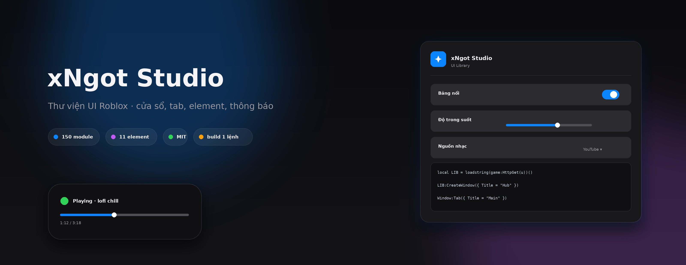

<div align="center">



# xNgot Library

**Bảng điều khiển xịn cho script Roblox — dựng cửa sổ, tab, nút bấm, thông báo, nhạc chỉ trong vài dòng.**

`v3.0.0` · `Miễn phí` · `MIT` · `Roblox / Delta / Codex`

**Tiếng Việt** · [English](#-english)

</div>

---

## 🇻🇳 Bạn nhận được gì

Một bộ giao diện hoàn chỉnh, chạy được ngay, không cần cài đặt gì thêm:

- 🪟 **Cửa sổ** kéo được, đổi kích thước được, có nút thu nhỏ, phím tắt và nút nổi trên màn hình.
- 🗂️ **Tab không giới hạn** — mỗi tab một icon, thêm bao nhiêu cũng được.
- 🎛️ **11 loại thành phần**: khung nhóm, nút bấm, công tắc, thanh kéo, ô nhập, danh sách chọn, bảng màu, đoạn văn, khối code, hộp thoại, thẻ thông tin.
- 🔔 **Thông báo trượt** ở góc màn hình: thường / thành công / cảnh báo / lỗi.
- 🎵 **Nhạc**: gõ mô tả kiểu *"lofi chill buổi tối"* là nó tự tìm, tự chọn bài, tự tải và phát.
- 🎨 **Đổi giao diện**: 7 bảng màu, 6 màu nhấn, đổi font, chỉnh độ trong suốt, lưu thành profile riêng.
- 💾 **Tự lưu cài đặt**: tắt game mở lại vẫn còn nguyên lựa chọn của bạn.
- 🔒 **Khoá bằng key** nếu bạn muốn phát hành riêng cho người có key.

<table>
<tr>
<td width="50%"></td>
<td width="50%"></td>
</tr>
<tr>
<td align="center"><sub>Cửa sổ · tab · thành phần</sub></td>
<td align="center"><sub>Bảng nổi · thông báo</sub></td>
</tr>
</table>


---

## 🚀 Bắt đầu (30 giây)

Dán đoạn này vào executor, bấm chạy:

```lua
local LIB = loadstring(game:HttpGet("https://raw.githubusercontent.com/xngotzume123/xNgotLibrary/refs/heads/main/dist/main.lua"))()

local Window = LIB:CreateWindow({
    Title = "My Hub",
    Icon = "sparkles",
    Version = "v1.0.0",
})

local Tab = Window:Tab({ Title = "Trang chính", Icon = "house" })

Tab:Button({ Title = "Xin chào", Callback = function()
    LIB:Notify({ Title = "Chào bạn", Content = "Thư viện đã chạy", Kind = "success" })
end })

Tab:Toggle({ Title = "Bật tính năng", Default = true, Callback = function(on)
    print("công tắc:", on)
end })

Tab:Slider({ Title = "Tốc độ", Value = { Min = 16, Max = 200, Default = 50 }, Step = 2 })
```

Xong. Cửa sổ hiện ra là dùng được ngay.

> 💡 Trên GitHub, rê chuột vào khối code sẽ thấy **biểu tượng copy** ở góc phải — bấm là chép, không cần bôi đen.

### Phím và nút cơ bản

| Muốn gì | Làm gì |
|---|---|
| Ẩn / hiện cửa sổ | Bấm **RightShift**, hoặc bấm nút tròn nổi trên màn hình |
| Đóng hẳn cửa sổ | Nút ✕ ở góc phải trên (có hỏi lại để khỏi bấm nhầm) |
| Di chuyển cửa sổ | Giữ chuột vào thanh tiêu đề rồi kéo |
| Đổi kích thước | Kéo mép dưới hoặc góc cửa sổ |
| Đổi màu, đổi font | Vào tab **Settings Ui** trong cửa sổ |

---

## 🎨 Dùng cho hub riêng của bạn

Mặc định, khi nạp xong thư viện sẽ mở sẵn một cửa sổ demo để bạn xem thử.
Nếu bạn muốn **chỉ lấy thư viện** rồi tự dựng giao diện của mình, thêm **một dòng** trước khi nạp:

```lua
getgenv().xNgotLibraryOnly = true   -- đặt TRƯỚC khi nạp

local LIB = loadstring(game:HttpGet("https://raw.githubusercontent.com/xngotzume123/xNgotLibrary/refs/heads/main/dist/main.lua"))()

local Window = LIB:CreateWindow({ Title = "Hub của tôi" })
```

Có cờ này thì không có cửa sổ demo nào tự mở — sạch sẽ, đúng ý bạn.

> Không có cờ cũng không sao: khi bạn tạo cửa sổ riêng, cửa sổ demo **tự đóng**,
> nên trên màn hình không bao giờ có 2 bộ giao diện chồng nhau.

### Bản nhẹ

Nếu mạng chậm, đổi `dist/main.lua` thành `dist/main.min.lua` — nhẹ hơn khoảng 25%, dùng y hệt.

---

## 🎵 Bảng nổi và nhạc

Cửa sổ đi kèm một **bảng nổi** nhỏ gọn, bật/tắt bằng nút trên cửa sổ:

```lua
local Island = Window:GetDynamicIsland()   -- tên hàm giữ nguyên như bản gốc

Island:Notify("Tiêu đề", "Nội dung", "success", 4)   -- thông báo trên bảng nổi
Island:Timer(300)                                    -- hẹn giờ 5 phút
Island:Expand("Music")                               -- mở trang nhạc

Island:MusicSearch("lofi chill buổi tối")             -- tìm nhạc bằng mô tả
Island:PlayMusic()                                   -- phát / dừng
Island:MusicVolume(65)                               -- âm lượng
```

Chế độ nhạc có sẵn 4 preset cho máy yếu / mạng chậm:

```lua
_G.xNgotMusicConfig:Preset("lowdata")     -- nhẹ nhất: ít kết quả, không ảnh bìa
_G.xNgotMusicConfig:Preset("fast")        -- nhanh
_G.xNgotMusicConfig:Preset("quality")     -- chất lượng cao
_G.xNgotMusicConfig:Preset("vietnamese")  -- ưu tiên nhạc Việt
```

---

## ❓ Câu hỏi thường gặp

**Không thấy cửa sổ đâu cả?**
Bấm **RightShift** hoặc tìm nút tròn nổi trên màn hình. Nếu vẫn không có, executor của bạn
chưa hỗ trợ — thử Delta hoặc Codex bản mới nhất.

**Nhạc không phát?**
Chạy `_G.xNgotMusicDoctor()` rồi xem dòng nào báo `FAIL`. Thường là executor thiếu quyền
`writefile` — đổi executor là xong.

**Máy yếu, bị giật?**
`_G.xNgotMusicConfig:Preset("lowdata")` và tắt vòng tiến trình: `Island:Set("Ring", false)`.

**Cài đặt của tôi có mất khi thoát game không?**
Không. Thư viện lưu vào `xNgotLibrary/Config/` trong thư mục executor.

**Tự dựng hub mà vẫn thấy cửa sổ demo?**
Thêm `getgenv().xNgotLibraryOnly = true` **trước** dòng nạp là chắc chắn sạch.

**Dùng thư viện này cho script bán được không?**
Được — giấy phép MIT, dùng thoải mái, chỉ cần giữ dòng bản quyền trong file.

---

## 📖 Tài liệu đầy đủ

Muốn biết hết mọi thứ: 43 hàm của cửa sổ, 11 loại thành phần, toàn bộ API bảng nổi,
cấu hình nhạc, khoá key, ví dụ hoàn chỉnh:

- 🇻🇳 [Hướng dẫn tiếng Việt](docs/LIBRARY.vi.md)
- 🇬🇧 [English manual](docs/LIBRARY.en.md)

---

## 💝 Ủng hộ tác giả

Thư viện miễn phí và không có quảng cáo. Nếu nó giúp ích cho bạn, một ly cà phê là đủ để mình có thêm động lực cập nhật 💛

<p align="center">
  
  
  
</p>

### 🏦 MB Bank

```
258781
```

<sub>Số tài khoản: **258781** · bấm biểu tượng copy ở góc phải khối trên để chép.</sub>

### 📱 MoMo

```
0394715753
```

<sub>Số điện thoại: **0394715753** · bấm biểu tượng copy ở góc phải khối trên để chép.</sub>

### 💳 PayPal

```
nguyentiendino@gmail.com
```

<sub>Email PayPal: **nguyentiendino@gmail.com** · bấm biểu tượng copy ở góc phải khối trên để chép.</sub>

> Cảm ơn bạn rất nhiều — dù là 10k hay chỉ một lời cảm ơn, mình đều trân trọng 🙏

---

## 📄 Giấy phép

MIT — xem [`LICENSE`](LICENSE). Dùng, sửa, chia sẻ, dùng trong script bán được — chỉ cần giữ
dòng bản quyền trong file.

**Tác giả:** xNgot Zume · [github.com/xngotzume123](https://github.com/xngotzume123)

<div align="right"><a href="#xngot-library">↑ lên đầu</a></div>

---

## 🇬🇧 English

<div align="center">

**A polished control panel for Roblox scripts — windows, tabs, buttons, notifications and music in a few lines.**

`v3.0.0` · `Free` · `MIT` · `Roblox / Delta / Codex`

</div>

### What you get

- 🪟 **Window** — draggable, resizable, minimises, hotkey, floating round button on screen.
- 🗂️ **Unlimited tabs** — each tab gets its own icon.
- 🎛️ **11 element types**: section, button, toggle, slider, input, dropdown, colorpicker, paragraph, code block, dialog, info card.
- 🔔 **Sliding notifications** — info / success / warn / error.
- 🎵 **Music** — type something like *"lofi chill for the evening"* and it finds, picks, downloads and plays it.
- 🎨 **Themes** — 7 palettes, 6 accent colours, fonts, opacity, saved as profiles.
- 💾 **Auto-save** — your choices are still there next time.
- 🔒 **Key system** — if you want to release your hub to key holders only.

### Quick start

```lua
local LIB = loadstring(game:HttpGet("https://raw.githubusercontent.com/xngotzume123/xNgotLibrary/refs/heads/main/dist/main.lua"))()

local Window = LIB:CreateWindow({ Title = "My Hub", Icon = "sparkles", Version = "v1.0.0" })
local Tab = Window:Tab({ Title = "Main", Icon = "house" })

Tab:Button({ Title = "Say hi", Callback = function()
    LIB:Notify({ Title = "Hello", Content = "The library is running", Kind = "success" })
end })

Tab:Toggle({ Title = "Enable feature", Default = true, Callback = print })
Tab:Slider({ Title = "Speed", Value = { Min = 16, Max = 200, Default = 50 }, Step = 2 })
```

> 💡 On GitHub, hover a code block and click the **copy icon** in its top-right corner.

| Want to | Do this |
|---|---|
| Hide / show the window | Press **RightShift**, or tap the floating round button |
| Close it for good | The ✕ button (asks for confirmation first) |
| Move it | Drag the title bar |
| Resize it | Drag the bottom edge or corner |
| Change colours and fonts | Open the **Settings Ui** tab |

### Use it for your own hub

```lua
getgenv().xNgotLibraryOnly = true   -- set BEFORE loading
local LIB = loadstring(game:HttpGet(".../dist/main.lua"))()
local Window = LIB:CreateWindow({ Title = "My Hub" })
```

The demo window never opens, and if you do create your own window the demo one closes itself —
you will never end up with two UIs stacked.

### Floating panel and music

```lua
local Island = Window:GetDynamicIsland()   -- function name is kept as-is

Island:Notify("Title", "Message", "success", 4)
Island:Timer(300)
Island:Expand("Music")
Island:MusicSearch("lofi chill for the evening")
Island:PlayMusic()
Island:MusicVolume(65)

_G.xNgotMusicConfig:Preset("lowdata")      -- also: fast · quality · vietnamese
```

### FAQ

**I don't see a window.** Press **RightShift** or look for the floating round button. If nothing
appears, update your executor (Delta or Codex work well).

**No sound?** Run `_G.xNgotMusicDoctor()` and check for a `FAIL` line — usually the executor
lacks `writefile`.

**Laggy on a weak device?** `_G.xNgotMusicConfig:Preset("lowdata")` and `Island:Set("Ring", false)`.

**Will I lose my settings?** No — they are stored in `xNgotLibrary/Config/`.

**Can I ship this in a paid script?** Yes — MIT licence, just keep the copyright line.

### Full manual

📘 [English manual](docs/LIBRARY.en.md) · 🇻🇳 [Hướng dẫn tiếng Việt](docs/LIBRARY.vi.md)

### 💝 Support the author

<p align="center">
  
  
  
</p>

**MB Bank**

```
258781
```

**MoMo**

```
0394715753
```

**PayPal**

```
nguyentiendino@gmail.com
```

<sub>Click the copy icon at the top-right of each block to copy it.</sub>

Free, no ads, no tracking. A coffee goes a long way — thank you! 💛

### License

MIT — see [`LICENSE`](LICENSE).

**Author:** xNgot Zume · [github.com/xngotzume123](https://github.com/xngotzume123)

<div align="right"><a href="#xngot-library">↑ back to top</a></div>
