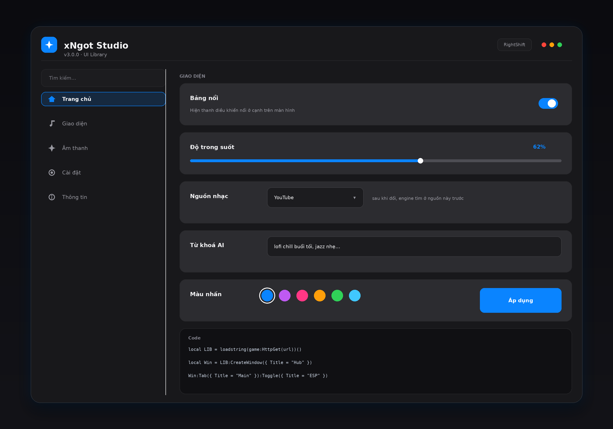
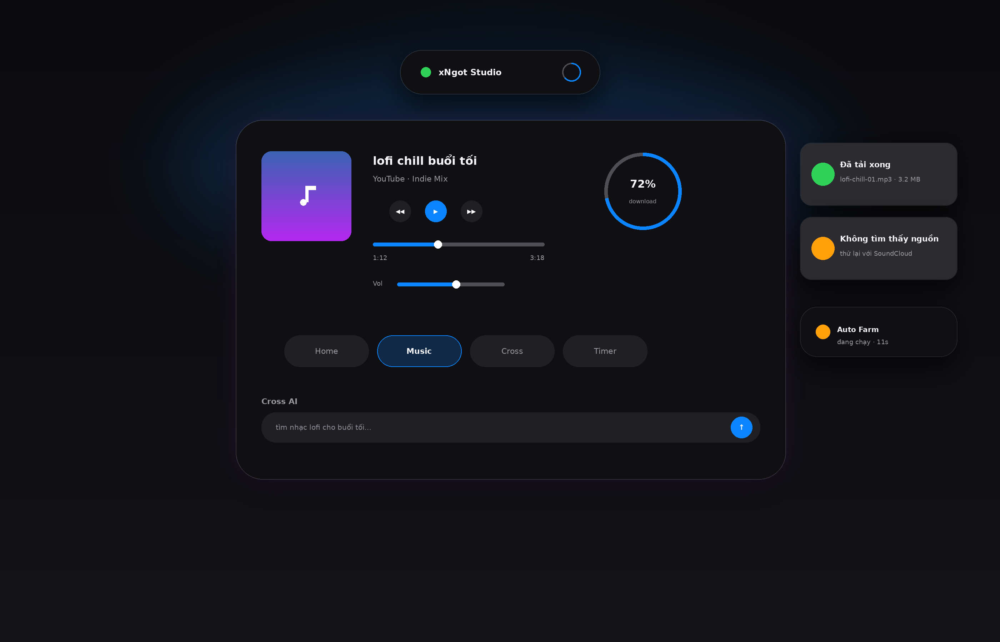
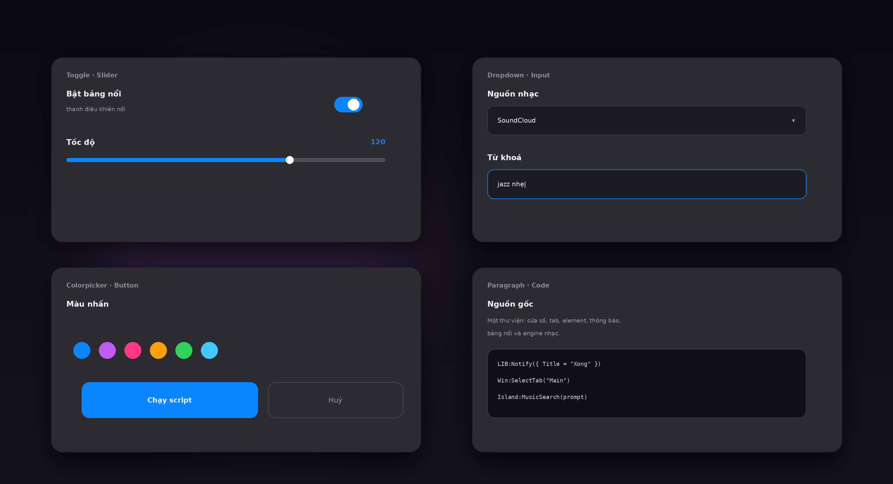

<div align="center">


# xNgot Library · Thư viện UI cho Roblox

**Một thư viện UI gọn nhẹ: cửa sổ, tab, element, thông báo, bảng điều khiển nổi và engine nhạc.**
Viết bằng Lua/Luau, chia thành 150 module, build và minify bằng Python.

`v3.0.0` · `26.511 dòng` · `150 module` · `11 loại element` · `MIT`

[](#-build)
[](#-cấu-trúc-repo)
[](#-build)
[](LICENSE)

**Tiếng Việt** · [English](#english)

</div>

---

## 🇻🇳 Tiếng Việt

### Nó là gì

`xNgot Library` là thư viện dựng giao diện cho script Roblox: bạn khai báo cửa sổ, tab và element
bằng bảng Lua, thư viện lo phần vẽ, kéo thả, lưu cấu hình và hiệu ứng.

<table>
<tr>
<td width="50%"></td>
<td width="50%"></td>
</tr>
<tr>
<td><b>Cửa sổ</b> — tab, section, toggle, slider, input, dropdown, colorpicker, code, dialog</td>
<td><b>Bảng nổi & thông báo</b> — thanh điều khiển gọn trên màn hình, thông báo trượt, thanh hoạt động</td>
</tr>
</table>



| Có gì | Chi tiết |
|---|---|
| **Cửa sổ** | tiêu đề, icon, kích thước, kéo thả, đổi kích thước, phím tắt, nút nổi, lưu cấu hình, KeySystem |
| **Tab** | không giới hạn số tab, mỗi tab có icon và nhánh cấu hình riêng |
| **Element** | Section · Paragraph · Code · Button · Toggle · Slider · Input · Dropdown · Colorpicker · Info · Discord |
| **Thông báo** | thẻ trượt góc màn hình với 4 mức: info / success / warn / error |
| **Bảng nổi** | thanh điều khiển gọn: thông báo, thanh hoạt động, hẹn giờ, đồng hồ, nhạc, trợ lý AI |
| **Engine nhạc** | tìm theo mô tả, chấm điểm, tải và phát từ YouTube / SoundCloud / Audius |
| **Giao diện** | 7 bảng màu, 6 màu nhấn, font, độ trong suốt, blur, profile giao diện, preset |
| **Log** | `Log`, `DevTools`, `Debug` để gỡ lỗi |

> Tên API trong mã nguồn được giữ nguyên (`Window.DynamicIsland`, `GetDynamicIsland()`,
> `IslandActivity()`…) vì chúng là một phần hợp đồng của thư viện — tài liệu chỉ gọi chúng
> bằng tên thân thiện "bảng nổi".

### Chạy thử

```lua
local LIB = loadstring(game:HttpGet(
    "https://raw.githubusercontent.com/xngotzume123/xNgotLibrary/refs/heads/main/dist/main.lua"))()

local Window = LIB:CreateWindow({
    Title = "My Hub",
    Icon = "sparkles",
    Author = "v1.0.0",
    Size = UDim2.fromOffset(580, 420),
})

local Tab = Window:Tab({ Title = "Main", Icon = "house" })
Tab:Section({ Title = "Cơ bản", Default = true })

Tab:Toggle({ Title = "Bật tính năng", Default = true, Callback = function(on)
    print("toggle:", on)
end })

Tab:Slider({ Title = "Tốc độ", Value = { Min = 16, Max = 200, Default = 50 }, Step = 2 })

Tab:Button({ Title = "Thông báo", Callback = function()
    LIB:Notify({ Title = "Xin chào", Content = "từ thư viện", Kind = "success", Duration = 4 })
end })
```

Thư viện không tự mở cửa sổ nào nếu bạn không yêu cầu — muốn tự dựng hub riêng:

```lua
getgenv().xNgotLibraryOnly = true   -- đặt TRƯỚC khi load
local LIB = loadstring(game:HttpGet(".../dist/main.lua"))()
```

📖 **Hướng dẫn đầy đủ** — 43 method `Window`, 11 loại element, ~40 hàm bảng nổi, engine nhạc,
cấu hình, KeySystem, FAQ: [`docs/LIBRARY.vi.md`](docs/LIBRARY.vi.md)

### Build

Yêu cầu **Python 3.9+**, không cần cài thêm gì.

```bash
python3 src/build.py                          # dev  → dist/xngot_studio.lua
python3 src/build.py --release                # ship → dist/main.lua
python3 src/build.py --release --minify        # + dist/main.min.lua (light)
python3 src/build.py --release --minify full   # + dist/main.min.lua (full: đổi tên + 1 dòng)
python3 src/build.py --check                   # kiểm tra toàn bộ module
python3 src/build.py --stats                   # thống kê theo nhóm
```

#### Tuỳ chọn minify

| Lệnh | Kết quả | Dòng | Dung lượng |
|---|---|---:|---:|
| *(không)* | `main.lua` — nguyên văn, còn comment | 26.055 | 954 KB |
| `--minify` | bỏ comment + thụt lề, **giữ tên** | 24.226 | 746 KB (−22%) |
| `--minify full` | bỏ comment, **đổi tên định danh cấp chunk**, dồn **1 dòng** | 1 | 711 KB (−26%) |
| `--minify full --no-rename` | dồn 1 dòng nhưng giữ nguyên tên | 1 | 721 KB |

Cách minify hoạt động:

1. **Tokenizer Lua/Luau tự viết** (`src/minify.py`) — hiểu chuỗi dài `[[ ]]`, comment, `+=`, `continue`.
2. **Bỏ comment + khoảng trắng**, chèn space/`;` ở đúng chỗ có thể dính token (`- -`, `1 .. 2`, `f(` đầu dòng).
3. **`full`: đổi tên 19 định danh cấp chunk** (`Log` → `pK`, `DevTools` → `mp`…) thành tên ngẫu nhiên.
   Chỉ đổi khi **không bị shadow** và **không dùng trước khi khai báo** (nên `require` bị loại).
4. **Tự kiểm chứng**: token stream của bản ra được so lại với bản gốc — lệch 1 token là build báo lỗi.
5. Đầu tệp minify luôn có 1 dòng bản quyền để không mất attribution.

#### Kết quả build hiện tại

| Tệp | Dòng | Dung lượng | Ghi chú |
|---|---:|---:|---|
| `dist/xngot_studio.lua` | 26.511 | 993 KB | dev, **trùng bản gốc từng byte** |
| `dist/xngot_studio.min.lua` | 1 | 725 KB | dev, minify full |
| `dist/main.lua` | 26.055 | 954 KB | release, bỏ 4 module debug |
| `dist/main.min.lua` | 1 | 711 KB | release, minify full |

> Tệp `.min.lua` có 1 dòng mã; `wc -l` báo 131 vì dữ liệu base64 nằm trong chuỗi dài `[[ ]]`
> vẫn giữ ký tự xuống dòng (thứ không thể bỏ mà không làm hỏng dữ liệu).

### Cấu trúc repo

```
xngot-studio/
├── src/
│   ├── build.py          build + minify (Python thuần)
│   ├── minify.py         tokenizer + minifier Lua/Luau
│   ├── manifest.json     thứ tự ghép, dòng nguồn, độ lệch khối, sha256
│   ├── profiles/         release.json
│   ├── stubs/            4 stub rỗng thay module debug ở bản release
│   └── modules/          150 module
├── tools/                split_source.py · verify_roundtrip.py · make_demo_images.py
├── docs/                 LIBRARY.vi.md · LIBRARY.en.md · demo/*.png
└── dist/                 4 tệp build
```

| Nhóm | Tệp | Dòng | Nội dung |
|---|---:|---:|---|
| `00_header` | 1 | 18 | banner |
| `10_config` | 6 | 181 | cấu hình nhạc (`_G.xNgotMusicConfig`) |
| `20_lib` | 16 | 2.572 | template giao diện: cửa sổ, tab, notification, dropdown, slider, dialog |
| `30_overlay` | 41 | 8.312 | bảng nổi, thông báo, hoạt động, hẹn giờ, nhạc, trợ lý AI |
| `40_window` | 35 | 6.132 | `CreateWindow`, mỗi element một tệp, tab Settings, KeySystem |
| `45_notify` | 1 | 68 | `LIB:Notify` |
| `50_icons` | 30 | 7.797 | 16 spritesheet + 1.548 icon dựng sẵn |
| `60_runtime` | 9 | 937 | Log / DevTools / debug panel |
| `70_boot` | 11 | 494 | khởi động, chọn nguồn, chế độ library-only |

### Vì sao tin được bản build

Bản gốc chỉ bị đụng **đúng 6 dòng** (gỡ 2 closure ngoài cùng) — chi tiết ở
[`docs/PROVENANCE.md`](docs/PROVENANCE.md). Kiểm chứng bất cứ lúc nào:

```bash
python3 tools/verify_roundtrip.py "main 2.txt" .
  ✔ A  phủ dòng: 26515 dòng nguồn phủ kín (26513 trong module, 4 dòng bỏ)
  ✔ B  ghép lại: khớp từng byte (26511 dòng)
  ✔ C  byte: build 2 lần giống hệt, trùng dist/xngot_studio.lua
  ✔ D  tái tạo: 150/150 module giống hệt khi chia lại từ bản gốc

diff "main 2.txt" dist/xngot_studio.lua   # đúng 4 hunk
```

Mỗi module có `sha256` + độ lệch khối ghi trong `manifest.json`; `--check` xác nhận từng tệp
trước khi ghép.

### Giấy phép

MIT — xem [`LICENSE`](LICENSE).

<div align="right"><a href="#xngot-studio--thư-viện-ui-cho-roblox">↑ lên đầu</a></div>

---

## 🇬🇧 English

### What it is

`xNgot Library` is a UI library for Roblox scripts: you declare a window, tabs and elements as
Lua tables, and the library handles drawing, dragging, resizing, config persistence and effects.

|  |  |
|---|---|
| **Window** — tabs, sections, 11 element types, dialogs | **Floating panel & notifications** — compact on-screen bar, sliding toasts, activity bar |

| What you get | Details |
|---|---|
| **Window** | title, icon, size, drag, resize, hotkey, floating button, config saving, KeySystem |
| **Tabs** | unlimited tabs, each with an icon and its own config branch |
| **Elements** | Section · Paragraph · Code · Button · Toggle · Slider · Input · Dropdown · Colorpicker · Info · Discord |
| **Notifications** | sliding cards with 4 kinds: info / success / warn / error |
| **Floating panel** | compact control bar: notifications, activity, timers, stopwatch, music, AI assistant |
| **Music engine** | prompt search, scoring, download & playback from YouTube / SoundCloud / Audius |
| **Appearance** | 7 palettes, 6 accents, fonts, opacity, blur, UI profiles, presets |
| **Logging** | `Log`, `DevTools`, `Debug` for troubleshooting |

> API names in the source are unchanged (`Window.DynamicIsland`, `GetDynamicIsland()`,
> `IslandActivity()`…) because they are part of the library's contract — the docs simply call
> them "floating panel".

### Run it

```lua
local LIB = loadstring(game:HttpGet(
    "https://raw.githubusercontent.com/xngotzume123/xNgotLibrary/refs/heads/main/dist/main.lua"))()

local Window = LIB:CreateWindow({ Title = "My Hub", Icon = "sparkles", Author = "v1.0.0" })
local Tab = Window:Tab({ Title = "Main", Icon = "house" })

Tab:Section({ Title = "Basics", Default = true })
Tab:Toggle({ Title = "Enabled", Default = true, Callback = print })
Tab:Slider({ Title = "Speed", Value = { Min = 16, Max = 200, Default = 50 }, Step = 2 })
Tab:Button({ Title = "Notify", Callback = function()
    LIB:Notify({ Title = "Hello", Content = "from the library", Kind = "success", Duration = 4 })
end })
```

The library opens nothing on its own unless you ask it to. For your own hub:

```lua
getgenv().xNgotLibraryOnly = true   -- set BEFORE loading
local LIB = loadstring(game:HttpGet(".../dist/main.lua"))()
```

📖 **Full manual** — 43 `Window` methods, 11 element types, ~40 floating-panel functions, music
engine, config, KeySystem, FAQ: [`docs/LIBRARY.en.md`](docs/LIBRARY.en.md)

### Build

Requires **Python 3.9+**, nothing else.

```bash
python3 src/build.py                          # dev  → dist/xngot_studio.lua
python3 src/build.py --release                # ship → dist/main.lua
python3 src/build.py --release --minify        # + dist/main.min.lua (light)
python3 src/build.py --release --minify full   # + dist/main.min.lua (full: renamed + one line)
python3 src/build.py --check                   # validate every module
python3 src/build.py --stats                   # per-group stats
```

#### Minify options

| Command | Output | Lines | Size |
|---|---|---:|---:|
| *(none)* | `main.lua` — untouched | 26,055 | 954 KB |
| `--minify` | comments + indentation stripped, **names kept** | 24,226 | 746 KB (−22%) |
| `--minify full` | comments stripped, **chunk-level names randomised**, collapsed to **one line** | 1 | 711 KB (−26%) |
| `--minify full --no-rename` | one line, original names | 1 | 721 KB |

How it stays safe:

1. **Hand-written Lua/Luau tokenizer** (`src/minify.py`) — understands `[[ ]]` long strings,
   comments, `+=`, `continue`.
2. Comments and whitespace are dropped; spaces / `;` are inserted exactly where tokens could
   merge (`- -`, `1 .. 2`, a line starting with `(`).
3. **`full` renames 19 chunk-level identifiers** (`Log` → `pK`, `DevTools` → `mp`…) to random
   names — only when a name is **not shadowed** and **not referenced before its declaration**
   (that's why `require` is skipped).
4. **Self-verification**: the output token stream is compared with the input — one mismatched
   token fails the build.
5. Every minified file keeps a one-line MIT/credit header.

### Repo layout

```
xngot-studio/
├── src/          build.py · minify.py · manifest.json · profiles/ · stubs/ · modules/ (150)
├── tools/        split_source.py · verify_roundtrip.py · make_demo_images.py
├── docs/         LIBRARY.vi.md · LIBRARY.en.md · PROVENANCE.md · demo/*.png
└── dist/         xngot_studio.lua · xngot_studio.min.lua · main.lua · main.min.lua
```

| Group | Files | Lines | Content |
|---|---:|---:|---|
| `00_header` | 1 | 18 | banner |
| `10_config` | 6 | 181 | music config (`_G.xNgotMusicConfig`) |
| `20_lib` | 16 | 2,572 | UI templates: window, tabs, notifications, dropdown, slider, dialog |
| `30_overlay` | 41 | 8,312 | floating panel, notifications, activity, timers, music, AI assistant |
| `40_window` | 35 | 6,132 | `CreateWindow`, one file per element, Settings tab, KeySystem |
| `45_notify` | 1 | 68 | `LIB:Notify` |
| `50_icons` | 30 | 7,797 | 16 spritesheets + 1,548 bundled icons |
| `60_runtime` | 9 | 937 | `Log` / `DevTools` / debug panel |
| `70_boot` | 11 | 494 | boot, source picking, library-only mode |

### Why you can trust the build

Only **6 lines** of the original are touched (removing two outer closures) — see
[`docs/PROVENANCE.md`](docs/PROVENANCE.md). Verify anytime:

```bash
python3 tools/verify_roundtrip.py "main 2.txt" .
  ✔ A  line coverage: all 26,515 source lines accounted for
  ✔ B  re-assembly: byte-identical (26,511 lines)
  ✔ C  bytes: two builds identical, equal to dist/xngot_studio.lua
  ✔ D  re-split: 150/150 modules identical when regenerated from source

diff "main 2.txt" dist/xngot_studio.lua   # exactly 4 hunks
```

### License

MIT — see [`LICENSE`](LICENSE).

<div align="right"><a href="#xngot-studio--thư-viện-ui-cho-roblox">↑ back to top</a></div>
